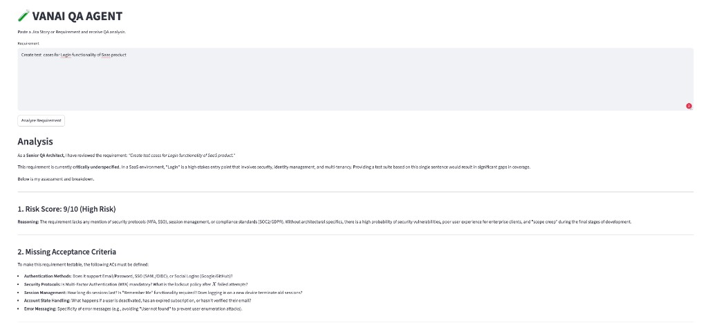
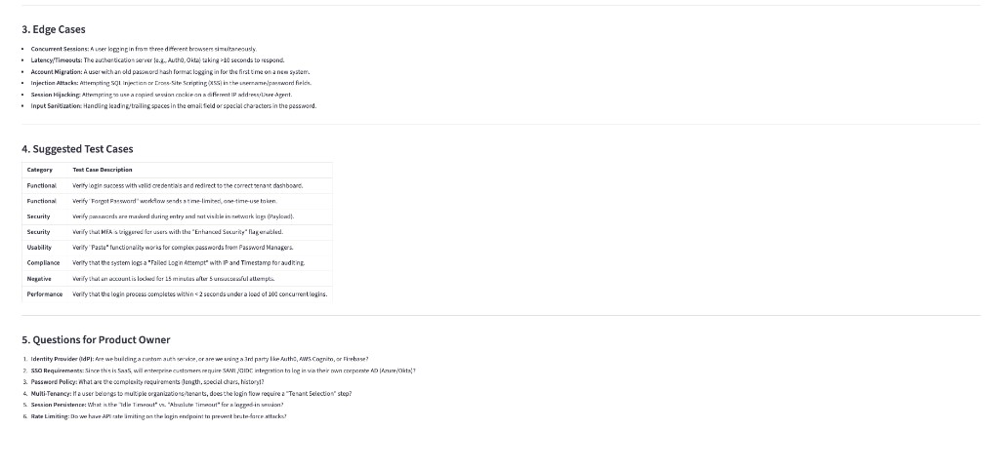

# # van.ai   ##### QA Studio

**AI-powered quality engineering, reimagined.**

van.ai QA Studio is an AI-powered QA assistant that reviews software requirements, including Jira stories, and generates structured quality insights using Google Gemini.

Paste a requirement, click **Analyze Requirement**, and get a risk score, missing acceptance criteria, edge cases, suggested test cases, and questions for the product owner — all in one place.

## Screenshots

**Requirement input and risk analysis**



**Edge cases, test cases, and product owner questions**



## Features

- **AI-powered requirement analysis** using Google Gemini
- **Risk assessment** with a score and rationale
- **Acceptance criteria review** to identify missing or ambiguous requirements
- **Edge-case identification** to uncover potential gaps
- **Test case generation** with steps, expected results, priorities, and test types
- **Product owner questions** to clarify requirements before development or testing
- **Customizable QA prompts** through `prompts/qa_review_prompt.txt`
- **Streamlit web interface** with an interactive analysis dashboard
- **Environment-based API key configuration** to keep credentials out of source control
- **Basic usage limits** to help control API consumption

## Project Structure

```text
vanai-qa-agent/
├── app.py
├── screenshots/
│   ├── screenshot-input.png
│   └── screenshot-analysis.png
├── services/
│   └── llm_service.py
├── prompts/
│   └── qa_review_prompt.txt
├── tests/
│   └── test_llm_service.py
├── requirements.txt
├── .env                 # Local API key; do not commit
├── .gitignore
└── README.md
```

## Prerequisites

- Python 3.9 or later
- A [Google Gemini API key](https://aistudio.google.com/apikey)
- Git

## Local Setup

### 1. Clone the repository

Replace `<repository-url>` with your GitHub repository URL.

```bash
git clone <repository-url>
cd vanai-qa-agent
```

### 2. Create and activate a virtual environment

```bash
python3 -m venv venv
source venv/bin/activate
```

### 3. Install dependencies

```bash
python -m pip install -r requirements.txt
```

### 4. Configure the Gemini API key

Create a `.env` file in the project root:

```env
GEMINI_API_KEY=your_api_key_here
```

**Security:** Never commit your `.env` file or expose your API key in GitHub, screenshots, logs, or public messages. For Streamlit Community Cloud, configure the key through the app's Secrets settings instead.

### 5. Run the application

```bash
streamlit run app.py
```

Open the local URL displayed in the terminal. By default, Streamlit uses `http://localhost:8501`.

## How It Works

1. The user enters a software requirement in the Streamlit interface.
2. `app.py` validates the input and applies the configured usage limits.
3. The application calls `analyze_requirement()` in `services/llm_service.py`.
4. The service loads the QA prompt from `prompts/qa_review_prompt.txt` and inserts the requirement.
5. The prompt is sent to Google Gemini for analysis.
6. The resulting QA feedback is presented in the dashboard, where supported outputs can be reviewed or downloaded.

## QA Analysis Output

The QA prompt instructs Gemini to review the requirement from a senior QA engineering perspective and return:

1. **Requirement Summary** — a concise interpretation of the requirement.
2. **Risk Score** — a score from 1 to 10, with supporting rationale.
3. **Missing or Ambiguous Acceptance Criteria** — unclear behavior and requirement gaps.
4. **Edge Cases** — scenarios that may be overlooked.
5. **Suggested Test Cases** — test scenarios, preconditions, steps, expected results, priorities, and test types.
6. **Questions for the Product Owner** — clarifications needed to make the requirement testable.
7. **Overall QA Recommendation** — a summary of readiness and key concerns.

To customize the analysis, edit `prompts/qa_review_prompt.txt`. Keep the `{requirement}` placeholder so the application can insert the user's input.

## Running Tests

The service tests use mocks to validate behavior without making live Gemini API calls or consuming API quota.

Activate the virtual environment, then run:

```bash
python -m pytest -v
```

## Dependencies

| Package | Purpose |
|---|---|
| `streamlit` | Web interface and dashboard |
| `google-generativeai` | Google Gemini API client |
| `python-dotenv` | Load local environment variables |
| `pytest` | Run automated tests |

## Troubleshooting

| Issue | Suggested fix |
|---|---|
| `command not found: streamlit` | Activate the virtual environment or run `python -m streamlit run app.py`. |
| `No module named 'google.generativeai'` | Run `python -m pip install -r requirements.txt` in the activated environment. |
| API key missing | Check that `GEMINI_API_KEY` is set in `.env` locally or in Streamlit Secrets when deployed. |
| API quota or rate-limit error | Check your Gemini API quota and usage limits. Wait for the applicable quota window to reset; do not assume repeated retries will resolve a quota exhaustion error. |
| Prompt file not found | Confirm that `prompts/qa_review_prompt.txt` exists in the project. |
| Tests cannot run | Install the test dependency with `python -m pip install pytest`, then run `python -m pytest -v`. |

## Live Application

Try **van.ai QA Studio**:

https://vanai-app-agent.streamlit.app/

## Future Direction

van.ai QA Studio is designed to explore how AI can support requirement analysis, risk identification, and test design — helping quality engineers identify gaps earlier and make testing more systematic.

*AI-assisted analysis supports QA engineers; it does not replace human review or product-owner clarification.*